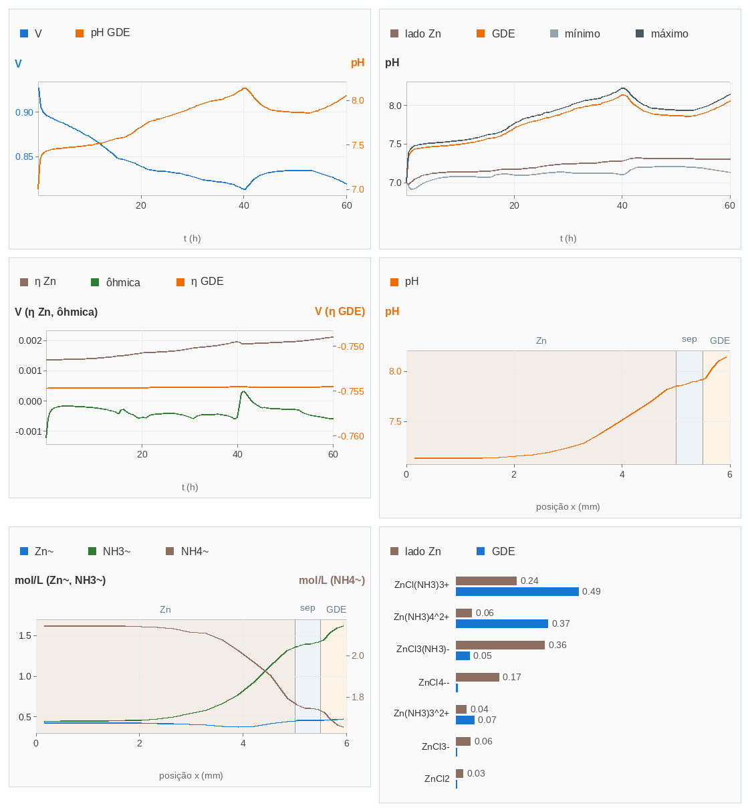
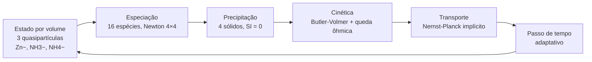
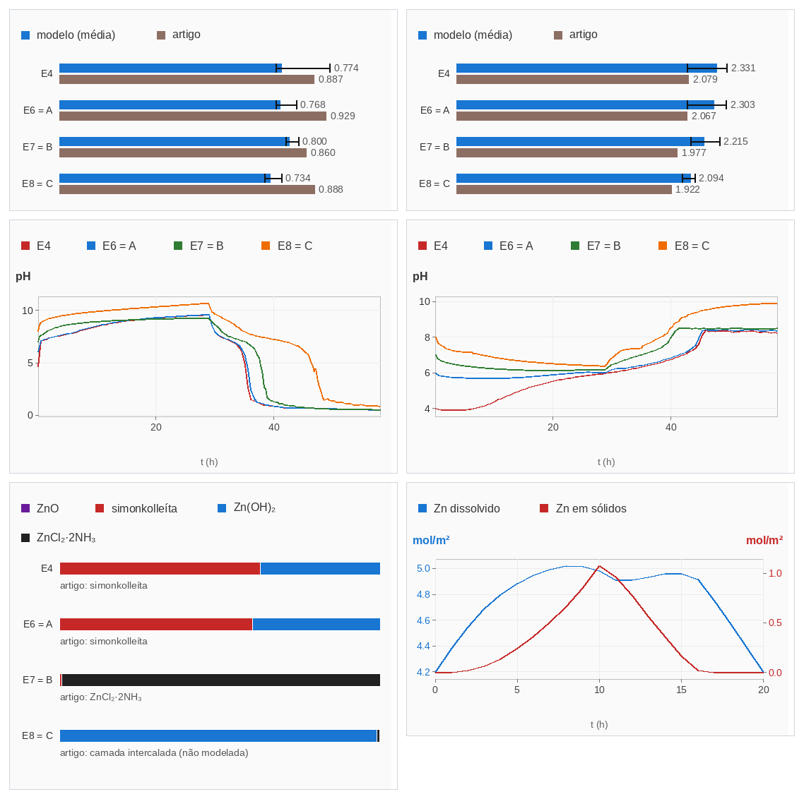

<h1 align="center">Modelagem de uma bateria zinco-ar<br>de eletrólito neutro</h1>

<p align="center">
  <em>Do artigo ao modelo: reconstrução crítica e implementação de um modelo físico-químico<br>de uma bateria zinco-ar recarregável com eletrólito aquoso ZnCl₂ + NH₄Cl.</em>
</p>

<p align="center">
  
  
  
  
</p>

<p align="center">
  
</p>
<p align="center"><sub>Painel de gráficos do simulador: tensão e pH do eletrodo de ar, pH por região, perdas de tensão, perfis espaciais e distribuição das espécies de Zn.</sub></p>

---

Este repositório documenta um trabalho de **engenharia reversa e reconstrução científica**. Partiu de um artigo publicado, passou por uma auditoria crítica de um simulador existente, refez o núcleo matemático do zero e validou o resultado contra os dados do artigo, com os desvios registrados.

O programa (Python + Tkinter, roda no celular) é o veículo. **O trabalho está no modelo, nas decisões e na validação.**

## Sumário

1. [O problema](#1-o-problema)
2. [Referência científica](#2-referência-científica)
3. [O trabalho: Etapa 1 e Etapa 2](#3-o-trabalho-etapa-1-e-etapa-2)
4. [Resultados da Etapa 1](#4-resultados-da-etapa-1)
5. [Premissas, calibrações e limites conhecidos](#5-premissas-calibrações-e-limites-conhecidos)
6. [Estrutura do repositório](#6-estrutura-do-repositório)
7. [Como executar](#7-como-executar)
8. [Citação e licença](#8-citação-e-licença)

## 1. O problema

Baterias zinco-ar com eletrólito neutro evitam a carbonatação do eletrólito alcalino, mas trocam um problema por outro. O pH local varia durante a operação, e dele dependem a especiação do zinco e a precipitação de sólidos (ZnO, hidróxidos, simonkolleíta, complexos amoniacais). Esses sólidos governam a capacidade, a passivação do eletrodo e a estabilidade do ciclo.

Prever esse comportamento exige acoplar:

- equilíbrio químico multiespécie;
- precipitação e dissolução;
- cinética eletroquímica nos dois eletrodos;
- transporte de massa e de carga no eletrólito.

## 2. Referência científica

> Clark, S.; Latz, A.; Horstmann, B. *ChemSusChem* **2017**.
> DOI: [10.1002/cssc.201701468](https://doi.org/10.1002/cssc.201701468)

O artigo e o seu *Supporting Information* são a base de todas as constantes termodinâmicas (Tabela 1) e do formalismo de **quasipartículas** (Eqs. 21–23). Quando um parâmetro **não** vem do artigo e foi calibrado, isso está declarado na [seção 5](#5-premissas-calibrações-e-limites-conhecidos).

## 3. O trabalho: Etapa 1 e Etapa 2

**Etapa 1** (3.1 a 3.3): reconstrução do simulador a partir do artigo de 2017. **Etapa 2** (3.4): validação experimental, dois anos depois, contra os experimentos de 2019. As duas etapas estão no mesmo programa, em páginas separadas.

### 3.1 Auditoria do simulador original

Análise crítica de um simulador anterior de cerca de 3.400 linhas. Principais achados:

| Achado | Consequência |
|---|---|
| Simulava só descarga galvanostática, sem carga real | Metade do ciclo ausente |
| Funções de Butler-Volmer definidas mas não usadas | Sem sobrepotenciais; tensão inicial praticamente de equilíbrio |
| Sólidos precipitados inertes | Sem efeito sobre transporte ou passivação |
| Instabilidade numérica com passo de tempo acima de 0,2 s | Resultados dependentes do passo |
| "Validação" por ajuste de um único parâmetro contra curvas digitalizadas | Validação fraca |
| Simonkolleíta nunca precipitava | Sequência de fases incorreta |

### 3.2 Reconstrução do núcleo (v2)



- **Estado reduzido a 3 quasipartículas** por volume (Zn~, NH₃~, NH₄~). Cloreto e nitrogênio total saem da eletroneutralidade.
- **Especiação:** 16 espécies aquosas, 12 constantes de equilíbrio, Newton 4×4 em variáveis logarítmicas com Jacobiana analítica, vetorizado.
- **Precipitação:** 4 sólidos (ZnO, simonkolleíta, Zn(OH)₂, ZnCl₂·2NH₃) em equilíbrio local (índice de saturação = 0).
- **Cinética real:** Butler-Volmer para o Zn e para o eletrodo de difusão de gás (ORR e OER separadas), com potencial de difusão e queda ôhmica.
- **Transporte:** Nernst-Planck implícito (bloco-tridiagonal 3N×3N), passo de tempo adaptativo.
- **Zinco:** modelo de pasta (partículas esféricas com passivação por casca) ou de folha polida.
- **Protocolo:** segmentos de descarga, carga e repouso, em múltiplos ciclos.

### 3.3 Validação e verificação numérica

- **Conservação** dos invariantes Zn, Cl e N: deriva da ordem de 10⁻¹².
- **Sensibilidades** analíticas contra diferenças finitas: erro abaixo de 0,4%.
- **Fronteiras de solubilidade** comparadas com a Fig. 2a e o SI do artigo.
- **Ciclagem multi-ciclo** da célula de folha de Zn (3 ciclos de descarga 5 mA / 4 h e carga 2,5 mA / 8 h).

### 3.4 Etapa 2 — validação experimental (2019)

Dois anos depois do artigo de 2017, Clark, Mainar et al. mediram em células reais o que o modelo havia previsto ([arXiv:1902.04400](https://arxiv.org/abs/1902.04400)). Os eletrólitos A, B e C são os E6, E7 e E8 do novo artigo; o E4 (pH 4) é novo. A Etapa 2 roda no mesmo modelo as mesmas condições e compara com o artigo, **sem recalibrar nada**: ajustar nos mesmos dados e depois validar seria circular.

<p align="center">
  
</p>
<p align="center"><sub>Página de validação, modo completo: tensões de descarga e de carga (modelo contra Tabela 3), pH do ar e do lado Zn em ciclo longo, fases sólidas a 40% de DoD e balanço de Zn.</sub></p>

Cinco testes, com critérios declarados na própria tela:

| Teste | Referência no artigo | OK | DIVERGE | CONHECIDO |
|---|---|:---:|:---:|:---:|
| 1 · Condutividade iônica | Tabela 2 | 1 | 4 | 0 |
| 2 · Tensões e direções de pH | Tabela 3, Fig. 5 | 9 | 4 | 0 |
| 3 · pH operando | Figs. 7 e 8 | 3 | 10 | 0 |
| 4 · Fases sólidas a 40% de DoD | Fig. 9 | 4 | 0 | 1 |
| 5 · Autofreio e balanço de Zn | Fig. 12 | 2 | 2 | 0 |
| **Total** | | **19** | **20** | **1** |

**O que o modelo reproduz**

- A ordem do sobrepotencial entre os eletrólitos (E8 < E7 < E6 < E4) e as 4 direções de pH do E8 (Fig. 5).
- A fase dominante em E4, E6 e E7 (simonkolleíta, simonkolleíta, ZnCl₂·2NH₃) e a ausência de ZnO.
- O E7 como o eletrólito mais condutivo e o pH do lado Zn do E4 chegando a ~6.

**Onde diverge**

- **Condutividade:** o modelo dá 1,6 a 2,0 vezes o valor medido (Tabela 2). A causa não foi testada.
- **Tensão:** sobrepotencial médio de 1,36 a 1,56 V contra 1,03 a 1,19 V no artigo (ORR abaixo e OER acima).
- **pH do ar no E4:** o modelo sobe a ~9,6, não a ~6 como medido. A queda ácida na carga aparece também em E6, E7 e E8, onde o artigo não a observa no ponto de medição.
- **Autofreio (Fig. 12):** o modelo redissolve todo o precipitado na carga; o experimento mostra retenção e perda líquida de Zn.
- **Carga de 29 h:** em E4, E6 e E7 o Zn~ se esgota no lado do Zn e o balanço de Zn deixa de fechar (19 a 31% do Zn ciclado). O modelo não tem outra reação além da do Zn; o piso numérico é a causa provável.
- **E8:** o artigo observa uma fase em camadas intercalada com NH₃, ausente dos 4 sólidos do modelo (desvio conhecido).

O modo **completo** usa as condições do artigo (cerca de 6 min no PC; no celular, bem mais). O modo **reduzido** encurta três testes, e o resultado é marcado INDICATIVO, sem valor de comparação.

## 4. Resultados da Etapa 1

Descarga a 1 mA/cm², Zn de 5 mm, corte em 0,6 V.

| Eletrólito | Capacidade (mAh/cm²) | Densidade de energia (Wh/L) | Sequência de sólidos |
|:---:|---:|---:|---|
| A | 255 | 325 | simonkolleíta → Zn(OH)₂ |
| B | 158 | 212 | ZnCl₂·2NH₃ → simonkolleíta → Zn(OH)₂ |
| C | 139 | 185 | quase só Zn(OH)₂ |
| D (só ZnO) | 633 | 834 | ZnO |

Para o eletrólito D, o artigo reporta um pico de 952 Wh/L. O valor do modelo é da mesma ordem e abaixo.

A **ordem relativa** entre os eletrólitos e a **sequência de fases** são o resultado de interesse. Os números absolutos dependem das calibrações da seção 5.

## 5. Premissas, calibrações e limites conhecidos

Os desvios abaixo são registrados porque fazem parte do resultado.

**Calibrado, não vem do artigo**

- Correntes de troca da ORR e da OER, ajustadas a tensões digitalizadas das Figs. 5 e 8f. A do Zn vem do SI.
- Deslocamento de +1,0 em log₁₀ Ksp dos hidróxidos, para corrigir supersaturação irreal do eletrólito C.
- Simonkolleíta na forma por-Zn, para reproduzir o cruzamento de solubilidade do artigo.

**Desvios conhecidos**

- A tensão de descarga da célula de folha cai mais que no artigo (0,61 → 0,36 V em 4 h).
- A tensão de carga sobe mais (~2,6–2,8 V contra ~2,25 V).
- O eletrólito A sai otimista: a instabilidade de pH da Fig. 8d não é reproduzida.
- Não há rugosidade crescente do Zn, inundação do eletrodo de gás, balanço de H₂O nem atividades iônicas (o modelo usa concentrações).

**Escopo de verificação**

- Todo o teste da interface foi feito com *stubs* do Tkinter, nunca em Tk real. A interface do simulador foi aprovada visualmente pelo autor no aparelho; a página da Etapa 2 foi testada por simulação de ponta a ponta e por teste de layout, ainda sem aprovação no aparelho.
- Desempenho medido só em PC: descarga completa em 15–40 s.

## 6. Estrutura do repositório

```text
.
├── README.md
├── final6.py        # aplicação completa (núcleo + interface + gráficos + glossário + Etapa 2)
├── zba_v2.py        # núcleo v2 isolado, com CLI (etapa do processo)
├── graficos.png            # figura do topo deste README
└── graficos_validacao.png  # figura da Etapa 2
```

> [!NOTE]
> `zba_v2.py` é o núcleo v2 isolado, mantido aqui por fazer parte do processo: foi a etapa em que o modelo foi reconstruído e validado antes da interface. A versão de referência é o núcleo embutido em `final6.py`, que ganhou perfis espaciais, histórico ampliado e controle de execução.

## 7. Como executar

**Requisitos:** Python 3, `numpy`, Tkinter. Testado como alvo no Pydroid 3 (Android).

```bash
python final6.py        # interface gráfica
python zba_v2.py C      # núcleo via terminal: A | B | C | D | cellA
```

A interface traz 5 predefinições (eletrólitos A, B, C, D e a célula do artigo em 3 ciclos), protocolo configurável, 11 gráficos em Canvas puro (sem matplotlib), varredura de espessura de Zn × energia (análoga à Fig. 9) e um glossário de 151 verbetes técnicos com referências. O botão **VALIDAÇÃO 2019** abre a Etapa 2: 5 testes, placar, 8 gráficos e relatório em TXT.

## 8. Citação e licença

Se usar este trabalho, cite também o artigo-fonte ([seção 2](#2-referência-científica)).

> [!IMPORTANT]
> Este é um modelo de pesquisa e estudo. Não é uma ferramenta validada para projeto de produto.
